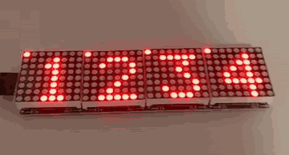
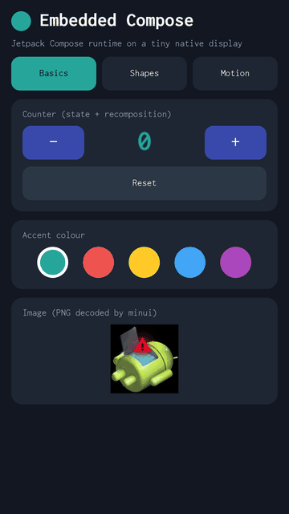
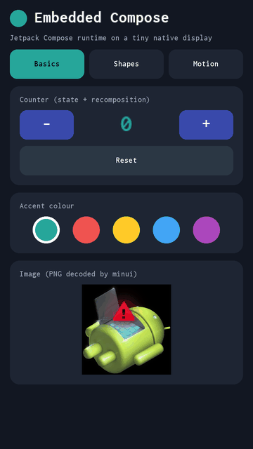
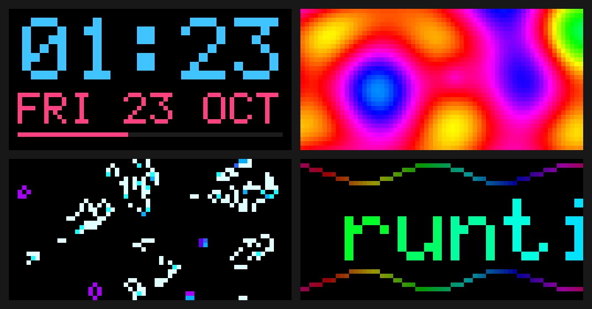

# embedded-compose

Jetpack Compose's runtime on bare embedded Linux. There is no Android
framework, no JVM and no Skia: the UI is one ~3 MB static binary that draws
straight into the kernel's display device (fbdev or DRM) or onto an LED
panel, and reads touch and keys from evdev.

<p align="center">
  <a href="docs/max7219-pi3.mp4"></a><br>
  <sub>A Compose app on a 4-in-1 MAX7219 LED board (32x8), driven by a Raspberry Pi 3
  (<a href="boards/rpi-max7219/README.md">rpi-max7219</a>). It is the playground's <i>LED test</i>
  example. <a href="docs/max7219-pi3.mp4">Video</a></sub>
</p>

| [Nexus 5X](boards/nexus5x/README.md) | [Generic arm64 QEMU](boards/qemu-virt/README.md) | [HUB75 LED panel on a Raspberry Pi](boards/rpi-hub75/README.md) |
|:---:|:---:|:---:|
|  |  |  |
| the demo, captured from the phone | mainline Linux, 720x1280 | 64x32 matrix; shown here from [QEMU's Pi 3](boards/qemu-rpi3/README.md) |

<sub>QEMU recordings run at emulator speed, not the device's.</sub>

## How it works

```
@Composable UI          apps/<app>         remember, mutableStateOf, LaunchedEffect, ...
androidx.compose.runtime                   Recomposer, snapshots, frame clock (official artifact)
toolkit                 core/ui            LayoutNode tree, Box/Row/Column/Text/Canvas/Button, Modifiers
platform contract       core/hal/ec_hal.h  fill, text, image, flip, input events, clock (C)
backend                 backends/          minui (fbdev/DRM/ADF), matrix + hub75/max7219 (LED panels)
kernel                  /dev/fb0, DRM, GPIO, /dev/input/event*
```

1. Kotlin/Native compiles the app, the Compose runtime and the toolkit into
   one static library. The Compose compiler plugin turns `@Composable`
   functions into calls on the runtime's `Composer`.
2. The toolkit plugs into the runtime as an `Applier`. Composition builds and
   updates a tree of `LayoutNode`s, which are measured, placed and drawn.
3. Drawing is spans of pixels: shapes become anti-aliased scanlines, sent
   through `ec_hal.h` to the board's backend, which writes them to the
   display and flips.
4. A single-threaded event loop drives everything: recomposition,
   `withFrameNanos` frames at 60 Hz while something animates, and input
   events. When nothing changes, it sleeps.

On the Nexus 5X the demo uses 7 MB of RAM idle and ~12 MB animating, at
~53 fps ([details](boards/nexus5x/README.md#how-lean)).

## Boards

| Board | Device | Status |
|---|---|---|
| [`nexus5x`](boards/nexus5x/README.md) | LG Nexus 5X, `fastboot boot` from RAM (nothing flashed) | runs on the phone |
| [`nexus5x-qemu`](boards/nexus5x-qemu/README.md) | the phone's 3.10 kernel on QEMU | UI test PASS |
| [`qemu-virt`](boards/qemu-virt/README.md) | generic arm64 QEMU, mainline Linux 6.12 | UI test PASS |
| [`rpi-hub75`](boards/rpi-hub75/README.md) | Raspberry Pi + HUB75 LED panel, on Raspberry Pi OS | builds; not yet tried on hardware |
| [`rpi-max7219`](boards/rpi-max7219/README.md) | Raspberry Pi + MAX7219 LED modules (32x8), on Raspberry Pi OS | runs on a Raspberry Pi 3 |
| [`qemu-rpi3`](boards/qemu-rpi3/README.md) | the rpi-hub75 build on QEMU's Raspberry Pi 3, no panel | driver runs |

## Apps

| App | |
|---|---|
| [`demo`](apps/demo/README.md) | the default: counter, shapes, animation, dragging |
| [`charger`](apps/charger/README.md) | an off-mode charging screen for phones (`APP=charger`) |
| [`matrix`](apps/matrix/README.md) | clock, plasma, Game of Life and a message for 64x32 LED panels (default on the LED boards) |

An app can also live outside this repo: `APP_DIR=<dir> ./ec build <board>`.

## Getting started

**Prebuilt:** [Releases](https://github.com/kaiwalyakhasnis/embedded-compose/releases)
has an image or archive for every board. QEMU archives need only
`qemu-system-arm`: unpack, then `./run.sh`.

**From source** (Ubuntu/Debian):

```sh
sudo apt install g++-aarch64-linux-gnu qemu-system-arm python3-pil openjdk-17-jdk-headless \
                 curl make bc bison flex libssl-dev   # the last ones build kernels
```

Gradle downloads Kotlin/Native and the Compose runtime on first use. Then,
for any board:

```sh
./ec boards                       # list them
./ec build qemu-virt              # app + backend + busybox + kernel (first time ~15 min)
./ec run qemu-virt                # boot it: a QEMU window, or the board's deploy
./ec test qemu-virt --minutes 10  # emulated boards: headless reliability test
./ec shot qemu-virt               # screenshot of the running board
./ec package qemu-virt            # release archive in out/qemu-virt/
APP=charger ./ec build qemu-virt  # another app
```

Board-specific setup, such as a phone in fastboot or a Pi over ssh, is in
each board's README. To support a new device, add a board; see
[boards/README.md](boards/README.md). A display minui can't drive needs a
backend: implement the display half of `core/hal/ec_hal.h`, as
`backends/matrix` does for LED panels.

## What the toolkit supports

Compose-style API: `Box`, `Row`, `Column`, `Spacer`, `Text`, `Canvas`, `Image`, `Button`.
Modifiers: `padding`, `size`, `fillMax*`, `weight`, `offset`, `background`,
`border`, `clickable`, `pointerInput`, `drawBehind`, `testTag`. Canvas: rects,
round rects, circles, ovals, lines, polygons and arcs, filled or stroked,
with alpha. The whole Compose runtime is available: state, effects,
`withFrameNanos`, `animateFloatAsState`.

Not yet: scrolling, clipping, text input, scalable fonts, transforms,
Material components. This is Compose's runtime with a small toolkit, not
Compose UI.

## Layout

```
ec                 build/run/test driver (./ec help)
apps/              demo/, charger/, matrix/
core/ui/           toolkit (Kotlin)          core/hal/  platform contract (C)
backends/          linux/ (evdev, clock, main), minui/ (display),
                   matrix/ (LED panels) with hub75/ and max7219/ (Raspberry Pi)
boards/            one directory per device: everything device-specific
tools/             init, cpio writer, QEMU launcher, UI test, GIF tour, bundle scripts
third_party/aosp/  minui + libpng/zlib/libdrm from AOSP android-8.1.0_r52, unmodified
```

Third-party code keeps its own licences: AOSP sources under Apache 2.0 and
their own notices (`third_party/aosp/`), and the fonts under OFL. Busybox,
Linux and (for the hub75 backend only) rpi-rgb-led-matrix, GPL-2.0, are
downloaded and built at build time, not included.
