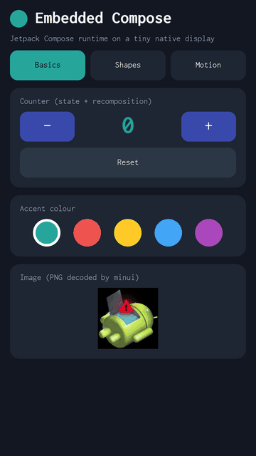

# embedded-compose

Jetpack Compose's UI on bare embedded Linux. There is no Android
framework, no JVM and **no Skia**: the UI is drawn straight into the kernel's
display device, **fbdev or DRM, whichever the device has**. The whole UI is
one ~3 MB static binary that boots from a 2.4 MB initramfs.

| Nexus 5X (real phone) | Nexus 5X kernel on QEMU | Generic arm64 QEMU (mainline Linux) |
|:---:|:---:|:---:|
|  |  |  |
| captured from the phone's framebuffer | 1080x1920, QEMU software CPU | 720x1280, QEMU software CPU |

<sub>Same binary and the same scripted tour on all three: counter, accent colour,
shapes, frame animation, `animateFloatAsState`, dragging. The QEMU GIFs run at
emulator speed, not the device's.</sub>

## How it works

```
@Composable UI          apps/demo          remember, mutableStateOf, LaunchedEffect, ...
androidx.compose.runtime                   Recomposer, snapshots, frame clock (official artifact)
toolkit                 core/ui            LayoutNode tree, Box/Row/Column/Text/Canvas/Button, Modifiers
platform contract       core/hal/ec_hal.h  fill, text, image, flip, input events, clock (C)
backend                 backends/minui     AOSP recovery's minui (vendored, unmodified)
kernel                  /dev/fb0 or DRM, /dev/input/event*
```

1. Kotlin/Native compiles the app, the Compose runtime and the toolkit to
   one static library. The Compose compiler plugin turns `@Composable`
   functions into calls on the runtime's `Composer`.
2. The toolkit plugs into the runtime as an `Applier`. Composition builds and
   updates a tree of `LayoutNode`s, which are measured, placed and drawn.
3. Drawing is spans of pixels. Shapes become scanlines (anti-aliased at the
   edges), sent to minui's `gr_fill`/`gr_blit`/`gr_text`. minui writes them
   into the framebuffer it found (ADF, DRM or fbdev) and flips.
4. A single-threaded event loop drives everything: recomposition,
   `withFrameNanos` frames at 60 Hz when something animates, and touch/keys
   from evdev. When nothing changes, it sleeps.

## How lean

Measured on the Nexus 5X (Snapdragon 808, 1080x1920) running the demo:

| | |
|---|---|
| UI binary | 2.9 MB (static, stripped: app + Compose runtime + minui + libpng/zlib) |
| Boot image ramdisk | 2.4 MB (binary + busybox + init + font) |
| App memory (RSS) | 7 MB idle after start, ~12 MB while animating |
| Whole system in use | ~140 MB of 1.8 GB, kernel included (no Android: init, the app, nothing else) |
| Animation | ~53 fps, 19 ms per frame (software rendering, one CPU core) |
| Boot to first frame | ~3 s after the kernel starts |

## Tested on

| Board | How | Result |
|---|---|---|
| **LG Nexus 5X**, physical | `fastboot boot` (RAM only, nothing flashed), LineageOS 15.1 kernel 3.10 | runs. Touch, keys and animation work, and the GIF above was captured from it |
| `nexus5x-qemu` | the phone's 3.10 kernel on QEMU, 1080x1920 | 10 min random input + 3 min animation: PASS |
| `qemu-virt` | mainline Linux 6.12 on QEMU, virtio-gpu, 720x1280 | 10 min random input + 3 min animation: PASS |
| `qemu-rpi3` | the HUB75 build on QEMU's Raspberry Pi 3 model, no panel | the driver starts, frames swap, keys arrive, SIGTERM turns the panel off |
| `rpi-hub75`, a real Pi + panel | Raspberry Pi OS, over ssh | builds; **not yet tried on hardware** |

A test "PASS" means: no crash or restart, memory flat, and after a long run
of random taps, drags and keys, a replayed sequence gives a pixel-identical
screen.

## Second app: a Compose charging screen

<p align="center"></p>

<sub>Recorded from the Nexus 5X's framebuffer, with the simulated battery to show a whole charge cycle.</sub>

`apps/charger` replaces Android's off-mode charging screen (`/sbin/charger`).
A glass orb fills with liquid (two waves, rising bubbles). Around it, a
glowing ring with a spark at its tip and an orbiting comet. Below, the level
in seven-segment digits, a pulsing bolt with energy flowing in, and the
current, voltage and temperature. Colour follows the level, from red to
green. It also does the stock charger's other jobs: it reads
`/sys/class/power_supply`, turns the screen off after 30 s and wakes on
touch or key, powers off 10 s after unplugging, and boots Android when
Power is held for 3 s.

On the phone it renders at ~30 fps (33 ms per frame). Large areas use
opaque, pre-mixed colours, because minui draws straight into uncached
framebuffer memory, where every translucent pixel costs a slow read.

```sh
APP=charger ./ec build qemu-virt && ./ec run qemu-virt     # simulated battery: Up/Down, Enter = plug
APP=charger ./ec build nexus5x && ./ec run nexus5x         # real battery, our minimal system
```

**In LineageOS's real off-mode charging**, tested on the Nexus 5X:
`boards/nexus5x/lineage-charger.py` makes a patched **copy** of a LineageOS 15.1
`boot.img`. It replaces `/sbin/charger`, adds the font, and sets the app's
environment in the `charger` service. With `--charger-mode` it also adds
`androidboot.mode=charger`, so a `fastboot boot` goes straight into
charging mode, RAM only:

```sh
APP=charger ./ec build nexus5x
boards/nexus5x/lineage-charger.py lineage/boot.img out/nexus5x/native/embedded-compose boot-charger.img --charger-mode
fastboot boot boot-charger.img      # hold Power 3 s: boots LineageOS
```

## LED matrices: HUB75 panels on a Raspberry Pi

<p align="center"></p>

<sub>The HUB75 build on QEMU's Raspberry Pi 3 (`qemu-rpi3`): the frames the app handed to
rpi-rgb-led-matrix, as its console prints them. Clock, plasma, Game of Life and a scrolling
message, one pixel per LED. Not yet photographed on a real panel.</sub>

The same toolkit and runtime also drive a 64x32 RGB LED panel (HUB75)
wired to a Raspberry Pi's GPIO header. The backend for it, `backends/hub75`,
draws each frame into a buffer in RAM. It hands the frame to
[rpi-rgb-led-matrix](https://github.com/hzeller/rpi-rgb-led-matrix), whose
real-time thread refreshes the panel, and swaps it in at the panel's
vertical sync. Text uses a built-in 5x7 font. The app, `apps/matrix`, has
four pages: a clock, a plasma, Game of Life and a scrolling message. Two
boards cover it:

| Board | What runs | Use it for |
|---|---|---|
| `qemu-rpi3` | the real HUB75 build on QEMU's Raspberry Pi 3 model, driving emulated GPIO; no panel | the driver path: init, refresh thread, vsync swaps, clean shutdown. The console shows the GPIO levels and the frame as coloured text |
| `rpi-hub75` | Raspberry Pi OS (64-bit) on a Pi 3, 4, 5 or Zero 2 W, with the panel | the real thing. `./ec run` copies a bundle over ssh and runs it; `./ec shot` fetches what the panel shows |

```sh
./ec build qemu-rpi3 && ./ec run qemu-rpi3
echo 'PI=pi@raspberrypi.local' > boards/rpi-hub75/local.env
./ec build rpi-hub75 && ./ec run rpi-hub75       # Ctrl-C stops it and turns the panel off
```

Panel and wiring are the library's own flags, e.g.
`HUB75_FLAGS='--led-rows=32 --led-cols=64 --led-gpio-mapping=adafruit-hat'`
in `boards/rpi-hub75/local.env`. On the Pi, turn the built-in audio off
(`dtparam=audio=off` in `/boot/firmware/config.txt`): it shares the PWM
hardware that times the panel, and the library refuses to start while it
is loaded. The bundle's README covers the rest: Pi settings, buttons on
GPIO, starting at boot. rpi-rgb-led-matrix is GPL-2.0.
It is downloaded and built for the hub75 backend only, so that backend's
binaries fall under the GPL.

## Try it

**Prebuilt:** [Releases](https://github.com/kaiwalyakhasnis/embedded-compose/releases) has a
`fastboot boot` image for the Nexus 5X, ready-to-run archives for the QEMU
boards (`./run.sh`, needs only `qemu-system-arm`), and the Raspberry Pi
HUB75 bundle (copy it to the Pi, then `./run.sh`).

**From source.** Requirements (Ubuntu/Debian):

```sh
sudo apt install g++-aarch64-linux-gnu qemu-system-arm python3-pil openjdk-17-jdk-headless \
                 curl make bc bison flex libssl-dev   # the last ones build the kernel
sudo apt install adb fastboot                          # only for the Nexus 5X
```

Gradle downloads Kotlin/Native and the Compose runtime on first use.

**In QEMU (no hardware needed):**

```sh
./ec build qemu-virt              # app, minui, busybox and a mainline kernel (first time ~15 min)
./ec run qemu-virt                # window: mouse = touch, arrows/Tab/Enter = keys
./ec test qemu-virt --minutes 10  # headless reliability test
./ec record qemu-virt my.gif      # the tour above as a GIF
```

**On a Nexus 5X** (bootloader unlocked). Nothing is written to the phone,
and a reboot returns it to its own system:

```sh
./ec build nexus5x                # also builds LineageOS 15.1's kernel from source
adb reboot bootloader
./ec run nexus5x                  # fastboot boot
```

`EC_DEV_USB=1 ./ec build nexus5x` adds a USB network shell for development.

Hold **Power for 3 s** to leave. With `EC_DEV_USB=1`, `boards/nexus5x/phone.py`
gives you the log, memory stats, screenshots and the GIF tour over USB.

**On another device:** add a board. `boards/<name>/board.sh` sets the kernel,
pixel format, density and font, and says how to boot it. See
[boards/README.md](boards/README.md). A display that minui can't drive (a 16-bit
SPI panel, an LED matrix) needs a new backend: implement the display half of
`core/hal/ec_hal.h`, as `backends/matrix` does for LED matrices (shown on
HUB75 panels by `backends/hub75`).

## What the toolkit supports

Compose-style API: `Box`, `Row`, `Column`, `Spacer`, `Text`, `Canvas`, `Image`, `Button`.
Modifiers: `padding`, `size`, `fillMax*`, `weight`, `offset`, `background`,
`border`, `clickable`, `pointerInput`, `drawBehind`, `testTag`. Canvas: rects,
round rects, circles, ovals, lines, polygons and arcs, filled or stroked,
with alpha. The whole Compose runtime is available: state, effects,
`withFrameNanos`, `animateFloatAsState`.

Not yet: scrolling, clipping, text input, scalable fonts, transforms,
Material components. This is Compose's runtime with a small toolkit, not
Compose UI.

## Layout

```
ec                 build/run/test driver (./ec help)
apps/demo/         the demo app
apps/charger/      off-mode charging screen (APP=charger)
apps/matrix/       for LED matrices, 64x32 and up (APP=matrix)
core/ui/           toolkit (Kotlin)          core/hal/  platform contract (C)
backends/          linux/ (evdev, clock, main), minui/ (display),
                   matrix/ (LED matrices) with hub75/ (Raspberry Pi)
boards/            qemu-virt/, nexus5x/, nexus5x-qemu/, rpi-hub75/, qemu-rpi3/:
                   everything device-specific
tools/             init, cpio writer, QEMU launcher, UI test, GIF tour, bundle scripts
third_party/aosp/  minui + libpng/zlib/libdrm from AOSP android-8.1.0_r52, unmodified
```

Third-party code keeps its own licences: AOSP sources under Apache 2.0 and
their own notices (`third_party/aosp/`), and the fonts under OFL. Busybox,
Linux and (for the hub75 backend only) rpi-rgb-led-matrix, GPL-2.0, are
downloaded and built at build time, not included.
