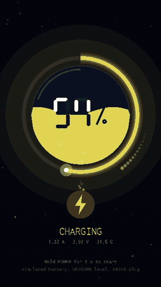

# charger: a Compose charging screen



A replacement for Android's off-mode charging screen (`/sbin/charger`). A
glass orb fills with liquid (two waves, rising bubbles). Around it is a
glowing ring with a spark at its tip and an orbiting comet. Below, the
level in seven-segment digits, a pulsing bolt with energy flowing in, and
the current, voltage and temperature. The colour follows the level, from
red to green.

It also does the stock charger's other jobs:
- reads the battery from `/sys/class/power_supply`;
- turns the screen off after 30 s, and wakes on touch or key;
- powers off 10 s after unplugging;
- boots Android when Power is held for 3 s.

Without a battery (QEMU), or with `EC_CHARGER_SIMULATE=1`, a simulated
battery charges in a loop. Up/Down change its level, and Enter plugs and
unplugs it.

```sh
APP=charger ./ec build qemu-virt && ./ec run qemu-virt   # simulated battery
APP=charger ./ec build nexus5x && ./ec run nexus5x       # the phone's battery, our minimal system
```

To run it inside LineageOS's real off-mode charging on the Nexus 5X, see
[boards/nexus5x](../../boards/nexus5x/README.md#the-charging-screen-in-lineageos).

On the phone it renders at ~30 fps (33 ms per frame). Large areas use
opaque, pre-mixed colours, because minui draws straight into uncached
framebuffer memory, where every translucent pixel costs a slow read. The
GIF was recorded from the phone's framebuffer with the simulated battery,
to show a whole charge cycle.
