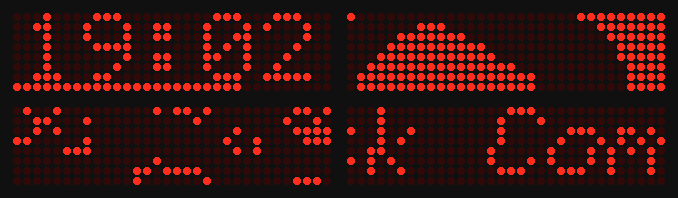

# rpi-max7219: MAX7219 LED modules on a Raspberry Pi



A "4 in 1" MAX7219 dot-matrix board (four 8x8 single-colour matrices,
32x8 LEDs, often sold as FC-16) on a Raspberry Pi's SPI pins, running the
[`matrix`](../../apps/matrix/README.md) app. The `max7219` backend draws
each frame into a buffer in RAM and sends the rows that changed through the
kernel's spidev driver. The MAX7219s keep showing what they were sent, so
there is no refresh thread. The app runs as a program on Raspberry Pi OS,
from a bundle that `./ec` copies over ssh.

The LEDs are one colour and either on or off: an LED is lit where the
app's colour is bright (its brightest channel at least `threshold`, 128 by
default), so any colour on black shows and dark greys don't. Brightness is
one setting for the whole board.

**Status:** builds. The picture shows the SPI bytes the binary sent,
decoded as a chain of four MAX7219s would. **Not yet tried on a real Pi
and module.**

## Hardware

| Part | Notes |
|---|---|
| Raspberry Pi 3, 4, 5 or Zero 2 W | 64-bit Raspberry Pi OS needed: there is no 32-bit build |
| MAX7219 4-in-1 board (FC-16) | the 5-pin header: VCC, GND, DIN, CS, CLK. Longer chains work: `modules=8` for two boards |
| 5 jumper wires (female-female) | |

Wiring, with the board's input header (DIN, not DOUT):

| Module | Raspberry Pi |
|---|---|
| VCC | 5V (pin 2) |
| GND | GND (pin 6) |
| DIN | MOSI, GPIO10 (pin 19) |
| CS | CE0, GPIO8 (pin 24) |
| CLK | SCLK, GPIO11 (pin 23) |

The MAX7219 is a 5 V chip and the Pi's pins are 3.3 V. That works with
almost every module. If you see garbage, put a 74AHCT125 level shifter on
DIN, CS and CLK. The Pi's 5 V pin can power one board at a low brightness;
at `intensity` above ~8 with many LEDs lit, use a separate 5 V supply
(GNDs joined).

## Set up the Pi

1. Install Raspberry Pi OS **Lite (64-bit)** with Raspberry Pi Imager, with
   SSH enabled.
2. Turn SPI on: `dtparam=spi=on` in `/boot/firmware/config.txt` (or
   `sudo raspi-config`, Interface Options, SPI), then reboot. Check that
   `/dev/spidev0.0` exists.

## Run it

**From source**, deployed from your PC. In `boards/rpi-max7219/local.env`:

```sh
PI=pi@raspberrypi.local                       # ssh login of the Pi
MAX7219_FLAGS='modules=4 intensity=2'         # optional, these are the defaults
```

```sh
./ec build rpi-max7219           # the bundle: out/rpi-max7219/bundle/embedded-compose/
./ec run rpi-max7219             # copies it to the Pi over ssh and runs it
./ec shot rpi-max7219            # PNG of what the LEDs show
```

On the Pi itself, `./run.sh` in the bundle runs it (as root; Ctrl-C stops
it and turns the LEDs off). To start it at boot, install
`embedded-compose.service` from the bundle; the file explains how.

## Settings

`EC_MAX7219` in the bundle's `ec.env` (from `MAX7219_FLAGS`), as
`name=value` words:

| | |
|---|---|
| `dev=/dev/spidev0.0` | the SPI device (CE1: `/dev/spidev0.1`) |
| `modules=4` | 8x8 modules in the chain; the app's screen is `8*modules` x 8 |
| `intensity=2` | brightness, 0–15 |
| `threshold=128` | an LED is on where the app's brightest colour channel is at least this |
| `flip=1` | the board mounted the other way up: header on the right, seen from the front |
| `block=90` | `90`, `180` or `270` if each 8x8 shows its part turned (modules wired unlike FC-16) |
| `hz=1000000` | SPI clock; lower it if long wires garble the picture |

The default orientation is an FC-16 board seen from the front with its
input header on the left. If the text is upside down, set `flip=1`; if the
letters are turned within each 8x8 block, try the `block` values.

## Buttons

As on [rpi-hub75](../rpi-hub75/README.md#buttons): any evdev input device,
a USB keyboard, or push buttons through the `gpio-key` overlay. SPI uses
GPIO 7–11; pins 5, 6, 12, 13, 16, 19, 20, 21 and 26 are free.
